<p align="center">
  <a href="https://1top.si">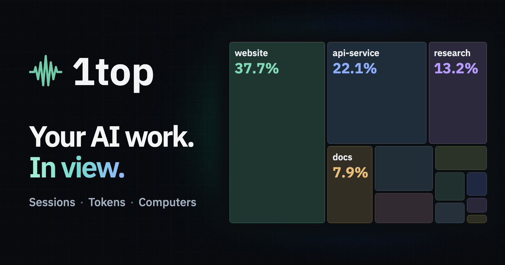</a>
</p>

<p align="center">
  <b>흩어진 AI 작업, 한눈에 보이게.</b><br>
  여러 앱과 컴퓨터에서 도는 AI 세션, 토큰, 계정 한도를 한곳에서 봅니다.
</p>

<p align="center">
  <a href="https://github.com/awesomezun/1top/releases/tag/v4.7.0"></a>
  
  
  <a href="LICENSE"></a>
</p>

<p align="center">
  <a href="https://1top.si"><b>웹사이트</b></a> ·
  <a href="https://1top.si/app?demo=1"><b>설치 없이 체험</b></a> ·
  <a href="#다운로드"><b>다운로드</b></a> ·
  <a href="#스크린샷"><b>스크린샷</b></a> ·
  <a href="README.md"><b>English</b></a>
</p>

<!-- gitreels:start -->
<p align="center">
  <a href="https://gitreels.com/awesomezun/1top"></a>
  <br>
  <a href="https://gitreels.com"></a>
  <a href="https://gitreels.com/awesomezun/1top"></a>
</p>
<!-- gitreels:end -->

어떤 AI가 어느 컴퓨터에서 돌고, 주간 한도를 얼마나 빨리 쓰며, 계정마다 얼마나 남았는지 보여 줍니다. 맥 메뉴 막대, 윈도우 트레이, 브라우저, 휴대폰 어디서나 자동차 계기판처럼 읽고, 실행 중인 세션과 바로 대화합니다.

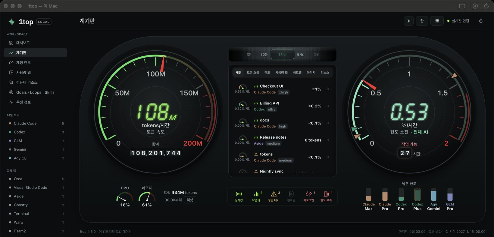

## 다운로드

| | 플랫폼 | 받기 |
| :---: | --- | --- |
|  | **macOS** · Apple Silicon, macOS 13 이상 | [**1top-4.7.0-macos-arm64.dmg**](https://github.com/awesomezun/1top/releases/download/v4.7.0/1top-4.7.0-macos-arm64.dmg) |
|  | **Windows** · x64 | [**1top-4.7.0-windows-x64-setup.exe**](https://github.com/awesomezun/1top/releases/download/v4.7.0/1top-4.7.0-windows-x64-setup.exe) |
|  | **Android** 7 이상 | [**1top-4.7.0-android.apk**](https://github.com/awesomezun/1top/releases/download/v4.7.0/1top-4.7.0-android.apk) · Google Play 준비 중 |
|  | **iPhone** | App Store 준비 중 |
| 🌐 | **브라우저** | [1top.si/app](https://1top.si/app?demo=1) — 체험은 설치가 필요 없습니다 |

4.7.0은 프리뷰입니다. 파일과 `SHA256SUMS`, `build-info.json`은 [릴리스](https://github.com/awesomezun/1top/releases/tag/v4.7.0)에 있습니다. 맥 앱은 아직 공증 전이고 윈도우 설치 파일은 아직 코드 서명 전이라, 처음 실행할 때 macOS와 Windows가 확인을 물을 수 있습니다.

**4.7.0에서 달라진 점:** 세션 도중 계정을 바꾸면 세션의 계정 표시도 따라 바뀌고, 윈도우 대시보드 창을 닫으면 맥처럼 웹 화면을 정리하며, 아무도 보지 않는 컴퓨터는 5분마다 보고하다가 휴대폰이나 웹으로 여는 순간 3초 간격으로 바뀝니다. 4.6.1에서는 메모리를 크게 줄였습니다.

## 볼 수 있는 것

| 항목 | 내용 |
| --- | --- |
| **계기판** | 토큰 속도와 한도 소진 다이얼, 지금 속도로 남은 작업 시간, 확인이 필요한 일을 알리는 경고등, 계정별 연료 게이지, 트립 계기. |
| **세션** | 컴퓨터, 앱, 터미널, AI 도구, 모델, 추론 강도, 상태, 계정, CPU와 메모리. 하위 에이전트는 시작한 세션 아래로 접힙니다. |
| **대화** | 질문이나 지시를 사진 3장까지 함께 보내고, 답을 마크다운으로 1top에서 읽습니다. 확인된 Orca 터미널의 Claude Code·Codex·GLM과 Aside에서 됩니다. |
| **계정 한도** | Claude Code, Codex, Agy CLI, GLM 계정의 5시간·주간 한도, 초기화 시각, 계정마다 쓰는 속도. |
| **사용량** | 입력, 캐시 입력, 캐시 쓰기, 출력. 세션·앱·도구·모델별 토큰 흐름과 사용량 맵을 10분부터 전체 기록까지 봅니다. |
| **Goals · Loops · Skills** | Codex Goal, Claude Code Goal, `/loop`와 예약 작업, 도구별로 설치된 스킬. |
| **제어** | 세션의 앱을 앞으로 가져오기, 지원되는 경우 작업 중단과 재개, CLI 종료. |
| **커스터마이징** | 기기마다 계기판과 대시보드의 개체를 옮기고, 숨기고, 크기와 모양을 바꿉니다. |

사용량은 보고된 토큰 기준이며 제공사 청구서나 구독 잔액이 아닙니다. 모르는 값은 모른다고 표시하고, 일부만 수집된 기록은 표시해 둡니다.

## 스크린샷

모든 화면은 [설치 없이 체험](https://1top.si/app?demo=1)과 같은 지어낸 예시 데이터로 찍었습니다. 앱은 한국어, 영어, 중국어로 씁니다.

### 대시보드

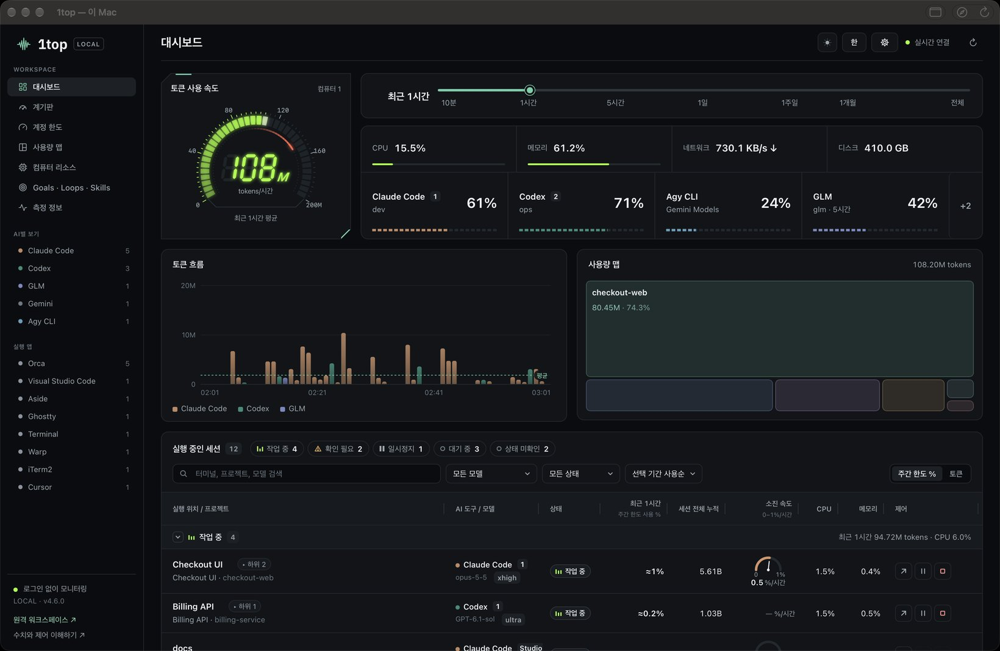

| 세션 | 사용량 맵 |
| --- | --- |
| 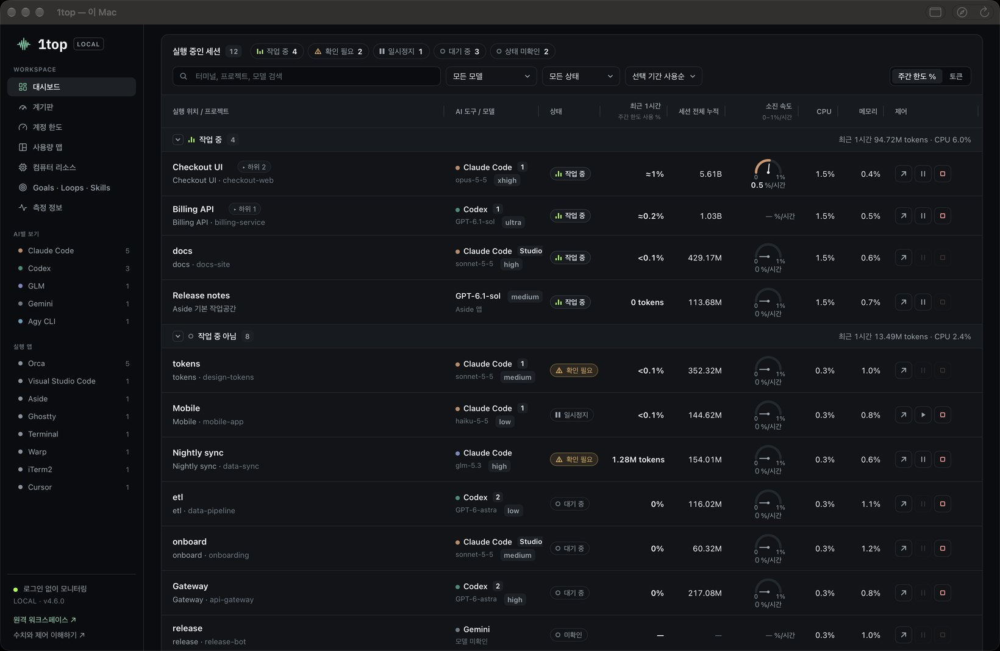 | 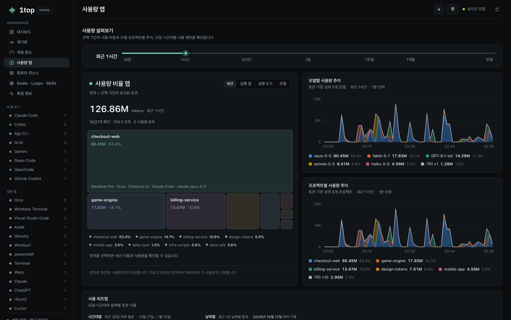 |
| **세션과 대화** | **계정 한도** |
| 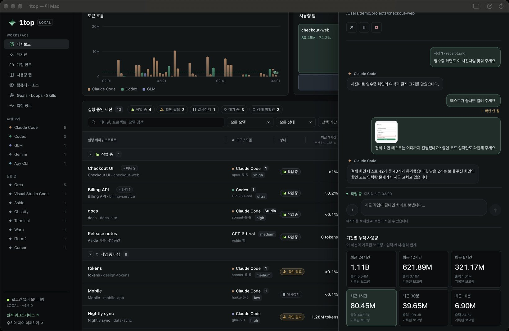 | 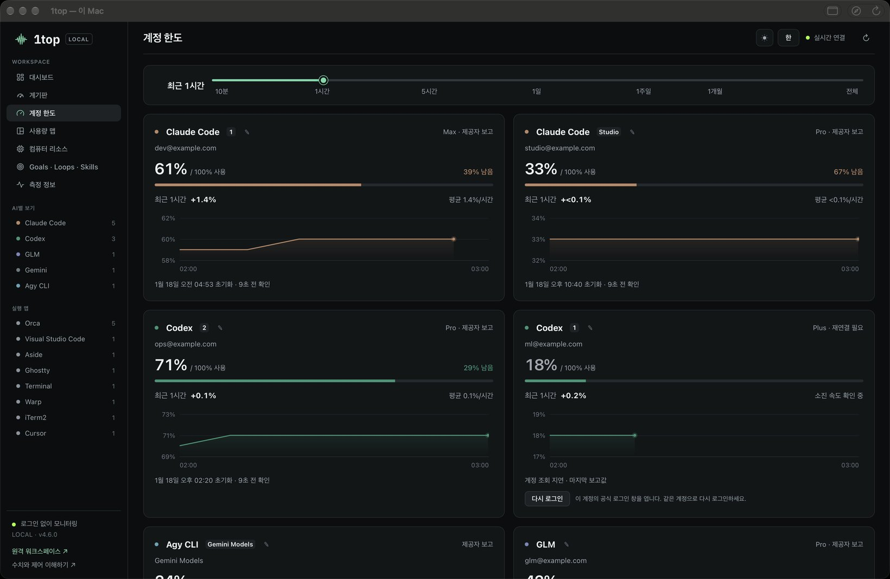 |
| **계기판의 토큰 흐름** | **계기판의 한도** |
| 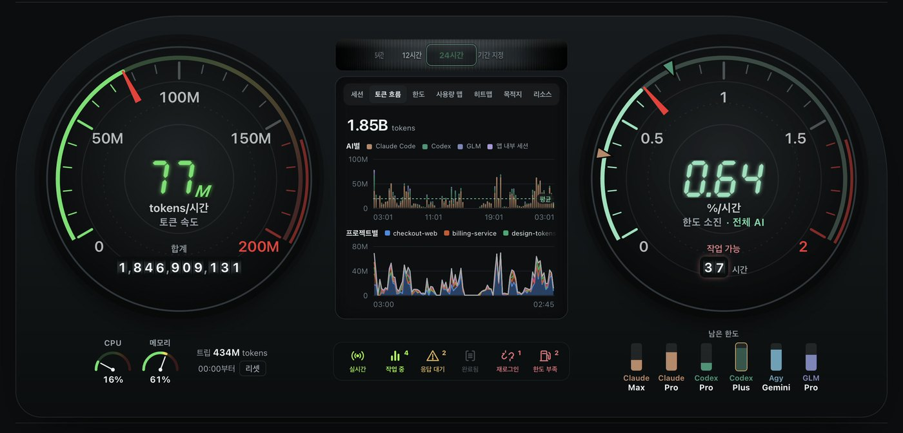 | 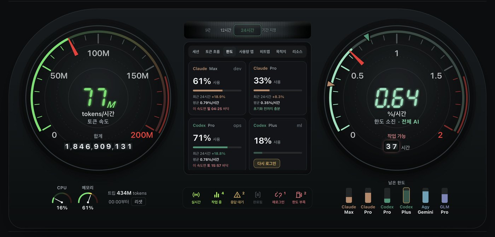 |

### 메뉴 막대와 트레이

| macOS 메뉴 막대 | 계기판으로 | Windows 트레이 |
| :---: | :---: | :---: |
| 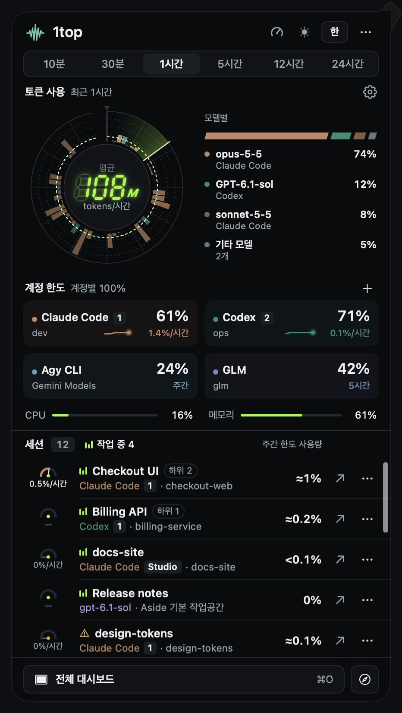 | 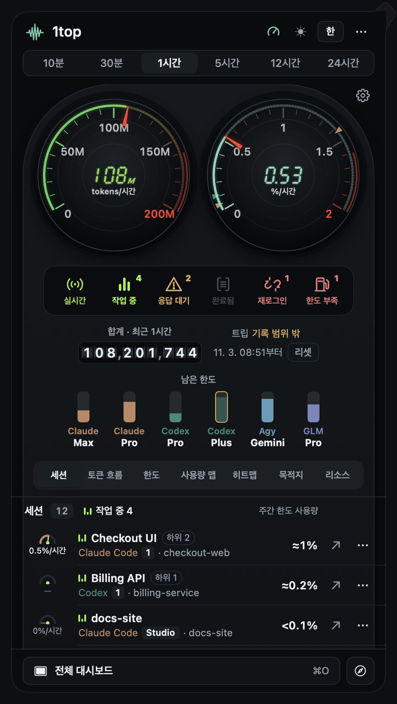 | 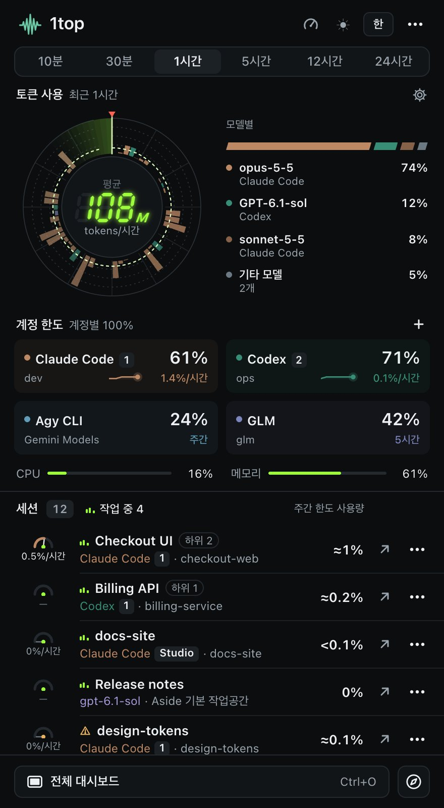 |

### 아이폰과 안드로이드

| | 대시보드 | 계기판 | 세션 | 한도 |
| :---: | :---: | :---: | :---: | :---: |
| **iPhone** | 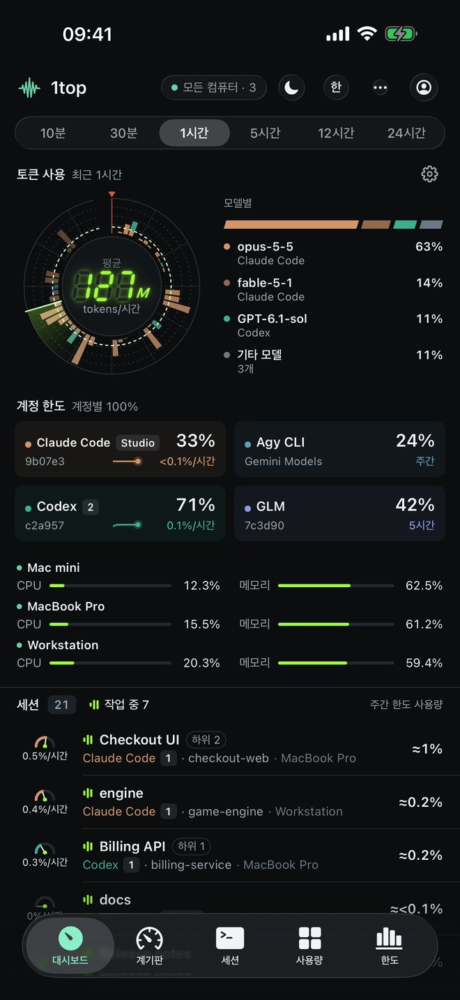 | 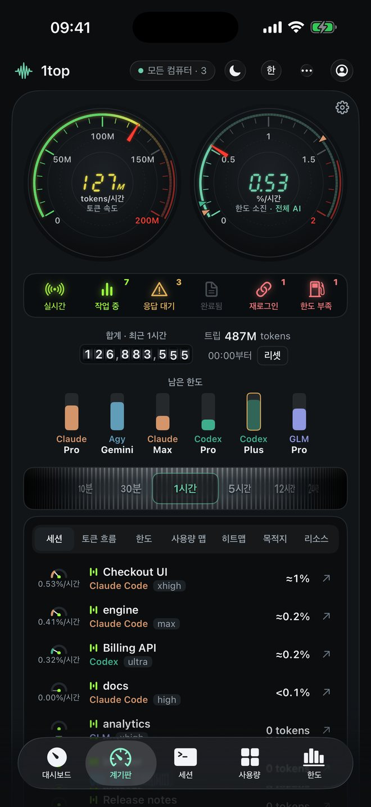 | 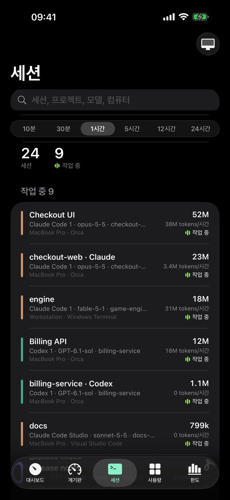 | 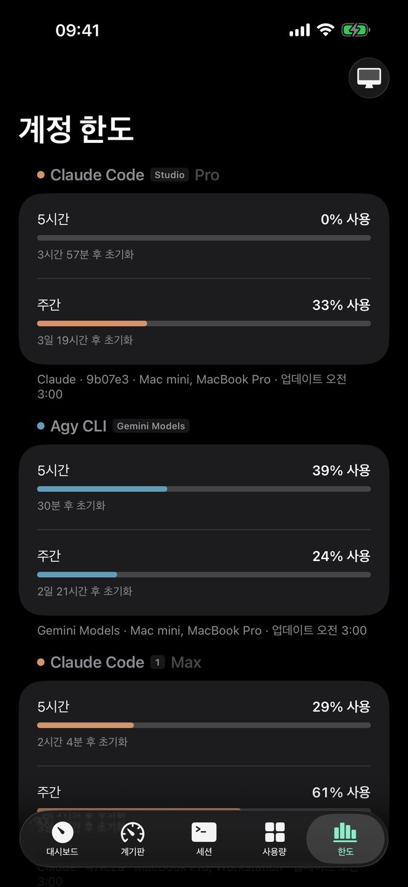 |
| **Android** | 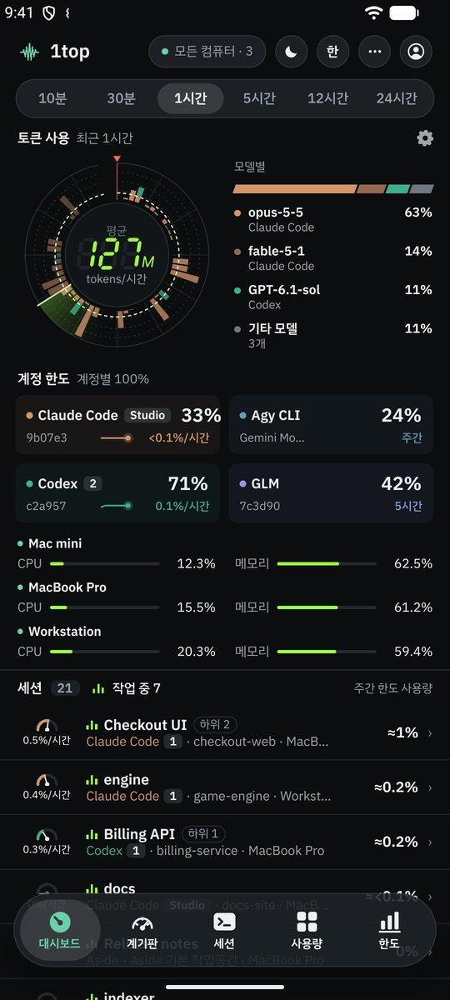 | 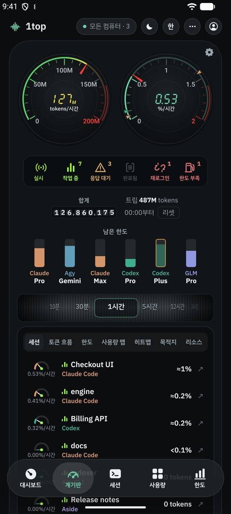 | 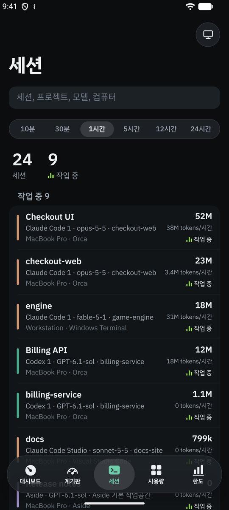 | 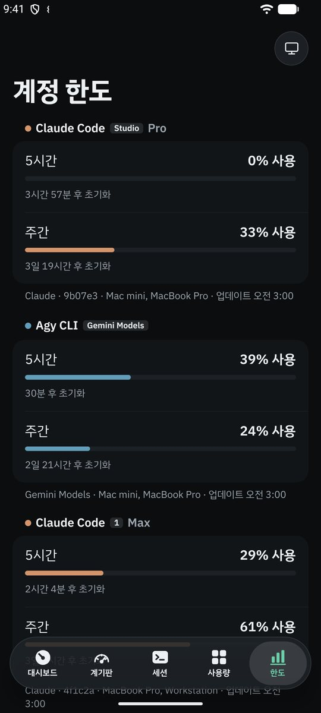 |

## 동작 방식

```text
 macOS 메뉴 막대 · Windows 트레이 · 대시보드 창 · 이 컴퓨터의 브라우저
                              │
                 1top 수집기 127.0.0.1 (루프백 전용)
                              │
          로컬 사용 기록 · 프로세스 · Goal과 스킬 파일
                              │  (선택, 밖으로 나가는 연결만)
                     1top 연결 서버 ──── iPhone · Android · 1top.si/app
```

데스크톱 앱이 각 AI 도구가 컴퓨터에 남기는 기록을 읽어 루프백 주소로만 보여 줍니다. 로컬 모니터링에는 계정이 필요 없습니다. 휴대폰이나 웹을 연결하면 컴퓨터가 요약을 연결 서버로 내보낼 뿐, 포트를 열지 않습니다.

제어에는 새로 받은 보고, 허용된 기능, 정확한 세션 키가 필요합니다. 명령은 시간이 지나면 사라지고, 꺼진 컴퓨터에는 쌓아 두지 않으며, 한 번만 실행됩니다. PID와 시작 시각을 대조해 재사용된 PID를 막고, CLI 종료는 그 프로세스에만 SIGTERM을 보냅니다.

## 개인정보

세션, 사용량, 기록은 컴퓨터에 남습니다. 연결 서버로 가는 요약에는 기기·앱·세션 이름, 모델 이름, 토큰 합계, 자원, 제어 결과만 담기고 대화 원문, 전체 파일 경로, API 키, 환경 변수, 명령줄 인수, Goal 본문, 스킬 경로는 빠집니다. 보낸 지시는 고른 세션으로만 가고, 연결 서버는 중복 확인용 지문만 남기며 본문은 저장하지 않습니다. 자세한 내용은 [개인정보 처리방침](https://1top.si/privacy)을 봐 주세요.

## 직접 빌드

Python 3.11 이상과 Node.js가 필요하고, macOS는 Xcode Command Line Tools도 필요합니다.

```bash
python3 -m venv .venv
.venv/bin/pip install -e . pyinstaller
.venv/bin/python -m unittest discover -s tests -q
.venv/bin/1top local
```

Apple Silicon 앱은 `scripts/build-macos.sh`로 빌드합니다(`build/1top_v<버전>/1top.app`, 임시 서명). Windows는 `scripts/build-windows.ps1`을 씁니다. 전체 검사 목록은 [`.github/workflows/checks.yml`](.github/workflows/checks.yml)에 있습니다.

## 기여

도구 어댑터를 더하는 방법은 [CONTRIBUTING.md](CONTRIBUTING.md)를 봐 주세요. 취약점은 [SECURITY.md](SECURITY.md)에 적힌 대로 비공개로 알려 주세요. 공개 이슈에 자격 증명, 실제 대화 기록, 개인 스크린샷을 올리지 말아 주세요.

[MIT 라이선스](LICENSE)
