# 1top

**흩어진 AI 작업, 한눈에 보이게.** AI 세션·터미널·토큰 사용량·컴퓨터 자원을 한곳에서 확인하는 오픈 소스 대시보드입니다.

[웹사이트](https://1top.si) · [설치 없이 체험](https://1top.si/app?demo=1) · [스크린샷](#스크린샷) · [다운로드](#다운로드) · [변경 사항](docs/release-notes_v3.6.0.md) · [English](README.md)

**v3.6.0 · 초기 프리뷰**

기본 흐름은 **1top 실행 → 독립 데스크톱 대시보드**입니다. 로컬 모니터링은 무료이고 로그인이나 중앙 중계 서버가 필요하지 않습니다. [아래 표](#다운로드)나 [다운로드 페이지](https://1top.si/#download)에서 Mac Apple Silicon DMG, Android APK를 받을 수 있습니다. Mac은 로컬 서명이며 공증 전, Windows는 Microsoft Store MSIX 배포를 준비 중이며 아직 Store에 공개되지 않았습니다. Android APK는 서명되어 있으며, iOS 스토어 배포는 준비 중입니다.

## 스크린샷

### 웹사이트

[1top.si](https://1top.si)는 1top이 하는 일을 24초 모션으로 먼저 보여 줍니다.

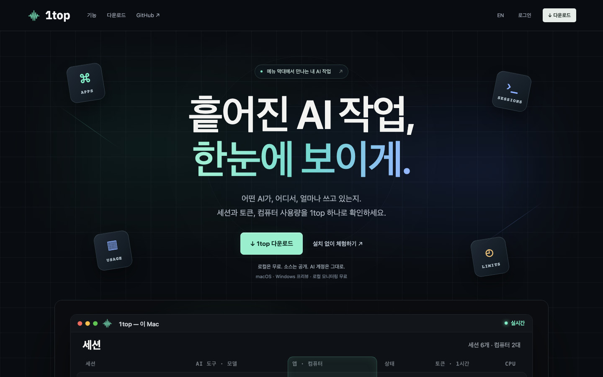

| 여러 앱·컴퓨터의 세션이 한 화면에 모입니다 | 기간을 바꾸면 모든 수치가 함께 바뀝니다 |
| --- | --- |
| 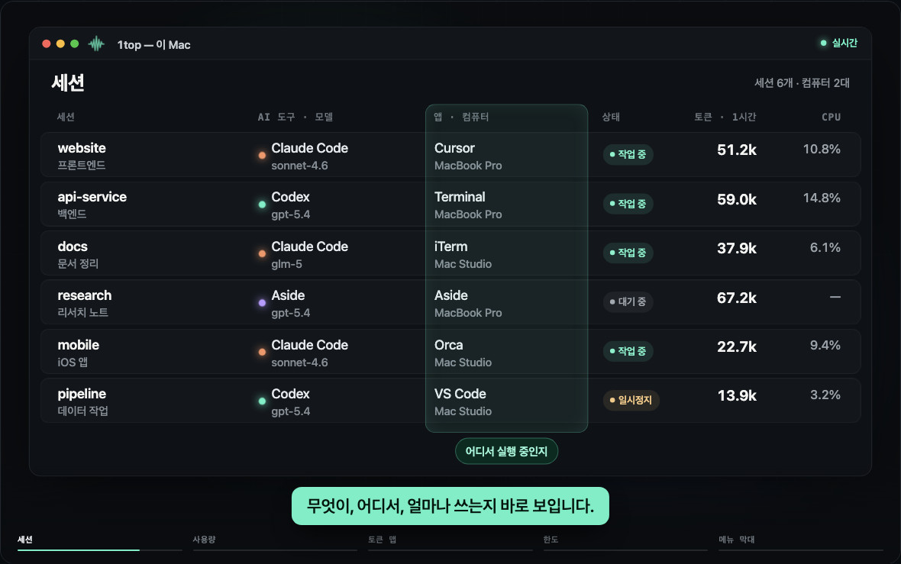 | 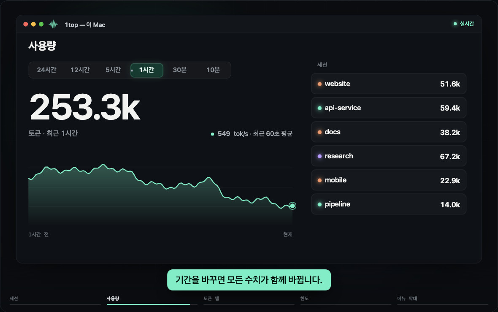 |
| **토큰 맵으로 사용량이 어디에 쓰였는지 봅니다** | **구독마다 5시간·주간 한도를 나란히 봅니다** |
| 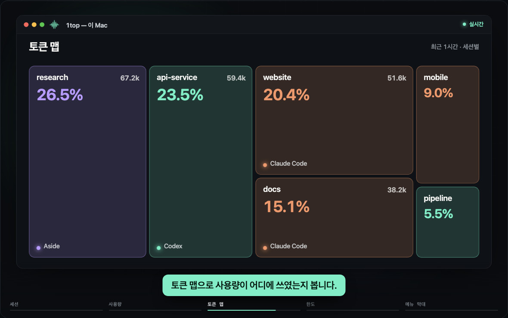 | 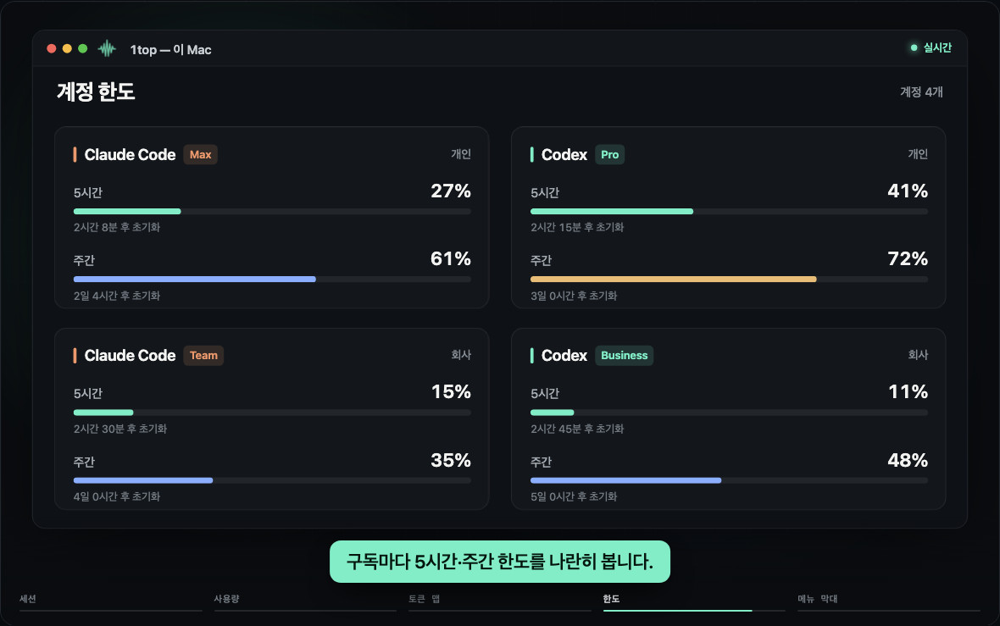 |

macOS 메뉴 막대의 1top 아이콘을 눌러 원하는 세션으로 바로 돌아갑니다.

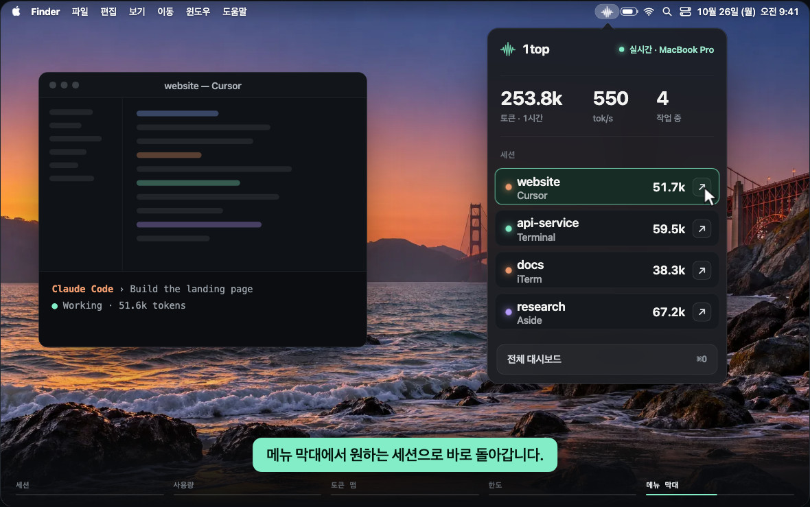

### 대시보드

[설치 없이 체험](https://1top.si/app?demo=1)에서 캡처했습니다. 예시 데이터이며 실제 기기를 제어하지 않습니다.

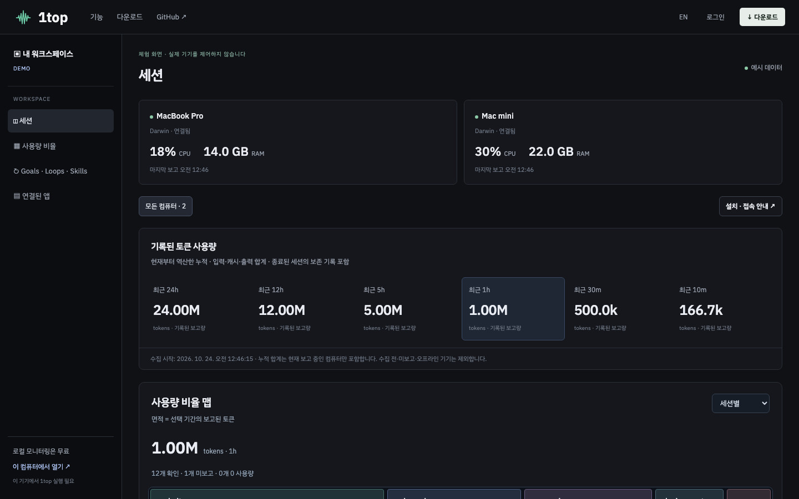

| 사용량 비율 맵 | 세션과 실행 위치 |
| --- | --- |
| 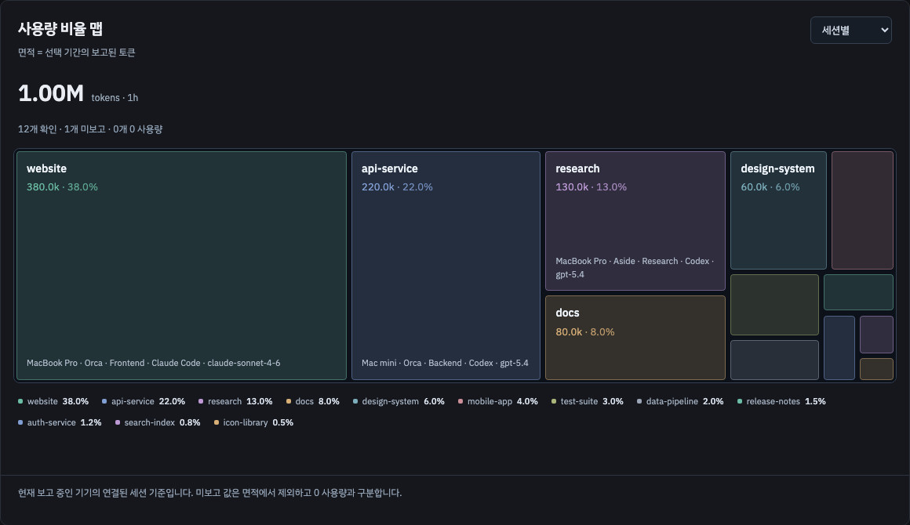 | 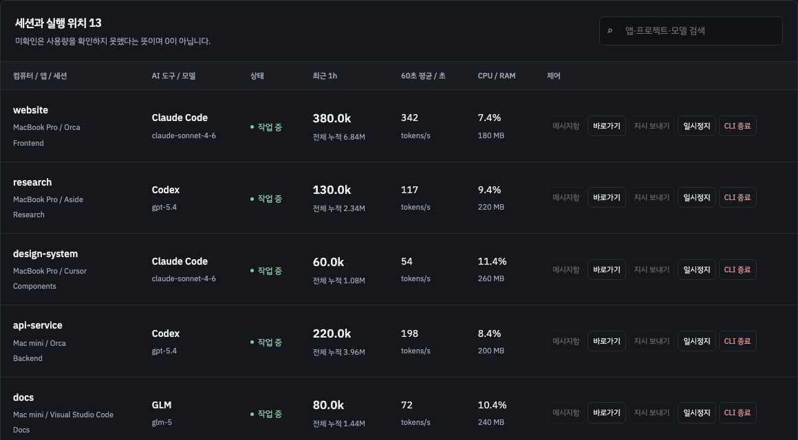 |

| 계정 한도: 5시간·주간 | 세션 메시지함 |
| --- | --- |
| 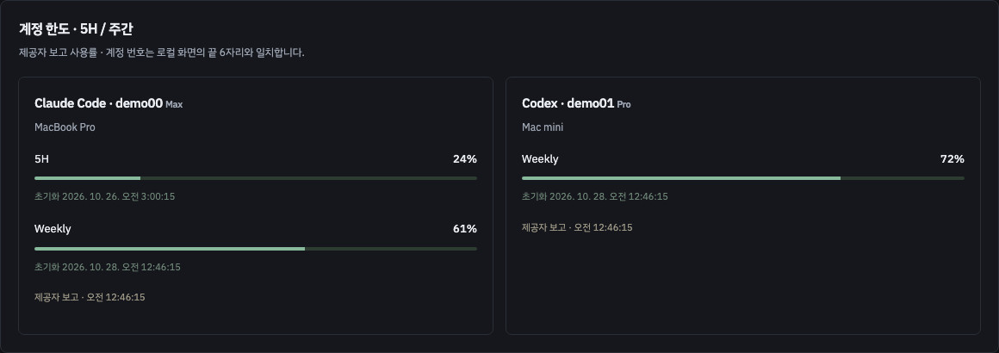 | 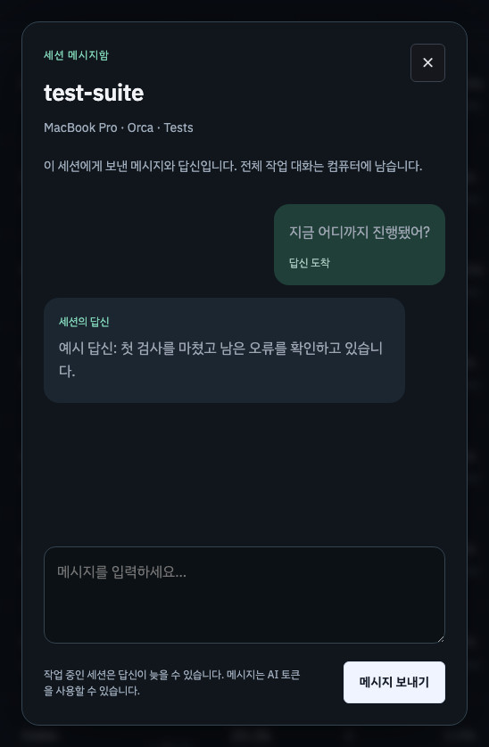 |

### macOS 앱

실제 앱을 예시 데이터로 녹화한 화면입니다.

| 데스크톱 대시보드 | 사용량 비율 맵 |
| --- | --- |
|  |  |

| 메뉴 막대 세션 요약 | 메뉴 막대 계정 한도 |
| --- | --- |
|  |  |

### Android

예시 데이터로 캡처한 영어 화면입니다.

| 세션 | 사용량 비율 | 구독 한도 |
| --- | --- | --- |
|  |  |  |
| **세션 메시지함** | **AI 세션에 지시 보내기** | **워크스페이스** |
|  |  |  |

## 다운로드

Windows v3.8.0부터 Microsoft Store용 MSIX 패키징을 제공합니다. 개발자 등록·심사는 완료 전이며, 아직 공개 Store 설치본은 없습니다. [배포 안내](docs/windows-store_v3.8.0.md). [이전 미서명 EXE 프리뷰](https://github.com/awesomezun/1top/releases/tag/v3.7.1)는 보존되어 있습니다.

| 플랫폼 | 파일 | 참고 |
| --- | --- | --- |
| macOS (Apple Silicon) | [1top-3.6.0-macos-arm64.dmg](https://github.com/awesomezun/1top/releases/download/v3.6.0/1top-3.6.0-macos-arm64.dmg) | 로컬 임시 서명입니다. Developer ID 서명과 공증은 준비 중입니다. SHA-256 `48a2cd8bdd05c010a51a36e0385d14fac730cc2eb514b82e32528b5779c7c2c2` |
| Windows x64 | Microsoft Store · 준비 중 | MSIX 패키징. 계정 본인 확인과 Store 심사 후 공개됩니다. |
| Android | [1top-1.5.0-android.apk](https://github.com/awesomezun/1top/releases/download/mobile-v1.5.0/1top-1.5.0-android.apk) | 서명된 프리뷰 APK입니다. SHA-256 `db4ba91ac0bb91bd0e1686b54432db14388993a092d35215f18cba6790d777c9` |
| iOS | — | 네이티브 빌드는 준비되었고, TestFlight·App Store 배포는 준비 중입니다. |

전체 릴리스는 [v3.6.0](https://github.com/awesomezun/1top/releases/tag/v3.6.0), [mobile-v1.5.0](https://github.com/awesomezun/1top/releases/tag/mobile-v1.5.0)에 있습니다. 프리뷰 파일은 정식 서명된 설치 파일의 검증 결과가 아닙니다.

## 할 수 있는 일

- 메뉴 막대 아이콘을 누르면 간략 대시보드, 전체 보기에서는 독립 앱 창
- 로그인된 계정에서 보고하는 5H·주간 한도와 초기화 시각. 해당하지 않는 한도는 생략하고, 확인 실패와 이전 캐시는 구분합니다.
- Aside 내부 세션 상태와 보고된 요청별 토큰 사용량
- 다크 모드 세션 표와 상세 패널, 앱·터미널 위치, CPU·메모리
- 세션·앱·도구·모델별 사용량 비율 맵. 작은 영역도 마우스 오버 또는 선택으로 수치를 확인합니다.
- 24시간·12시간·5시간·1시간·30분·10분의 기록된 토큰 합계
- Claude Code와 Codex의 Goal 상태, Claude Code `/loop`의 관측된 활동
- Skills 설치 목록과 호출 기록. 설치·활성화·작업 성공은 구분합니다.
- 지원되는 세션의 바로가기·작업 중단·새 요청으로 재개·CLI 종료
- 세션 메시지함: 웹과 모바일에서 세션에 따로 메시지를 보내고 그 답신을 받습니다. 세션의 전체 작업 대화를 옮겨 오지는 않습니다. 작업 중인 Orca 터미널은 현재 턴이 끝날 때까지 메시지를 기다리게 합니다.
- 원격 AI 지시: 모바일과 웹에서 글로 지시를 보냅니다. 입력을 받을 수 있는 대기 중 터미널 세션은 새 요청으로 받고, 작업 중인 Aside 세션은 현재 단계가 끝난 뒤 처리합니다. 지원되지 않거나 오래되었거나 대상이 모호하면 보낼 수 없습니다. 일반 셸 실행 경로는 열지 않습니다.

원격 접속은 선택 사항입니다. 현재 관리형 원격은 서버에서 승인한 계정만 사용할 수 있고 신규 기기 등록은 닫혀 있습니다. 공개 유료 가입과 본인 클라우드 자동 설치는 아직 준비 중입니다. 관리자 권한과 실제 결제 내역은 별개입니다.

미보고 토큰은 0이 아닙니다. Claude Code Goal은 마지막으로 관측한 기록이며, Loop의 현재 예약 상태·다음 실행 시각과 skill의 전체 작업 성공 여부는 확인하지 않습니다. Aside는 읽기 전용 로컬 기록으로 최근 24시간 및 작업 중 세션을 감지합니다. 세션별 CPU·메모리는 추정하지 않으며, 앱 바로가기와 지원되는 세션 중단을 제공합니다. 공유 앱 전체를 종료하지 않습니다.

자세한 설치·빌드·제한은 [README](README.md), [변경 사항](docs/release-notes_v3.6.0.md), [운영 정책](docs/service-policy_v1.0.0.md)을 확인하세요. 연결 설정과 관리형 결제 구성은 [중계 서버 안내](cloud/README.md)에 있습니다. 이전 안내는 [보존본](docs/archive/)에 있습니다.
