<p align="center">
  <a href="https://1top.si">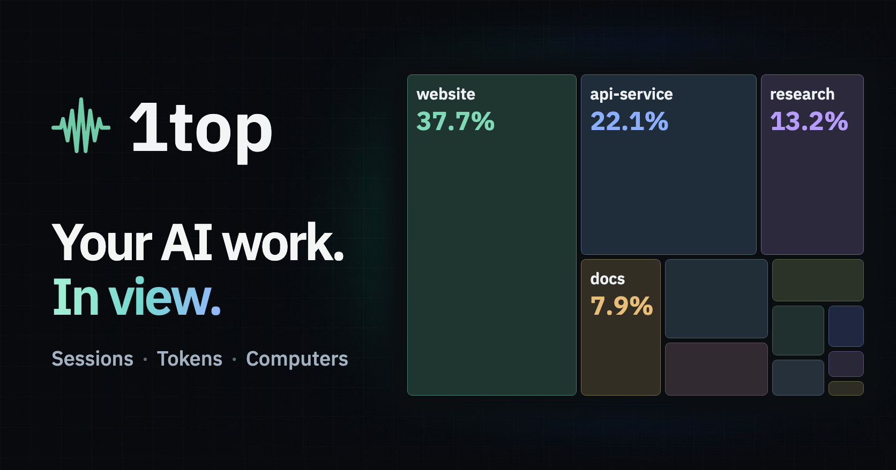</a>
</p>

<p align="center">
  <b>Your AI agents, sessions, tokens and limits — across apps and computers, in one view.</b>
</p>

<p align="center">
  <a href="https://github.com/awesomezun/1top/releases/tag/v4.8.0"></a>
  
  
  <a href="LICENSE"></a>
</p>

<p align="center">
  <a href="https://1top.si"><b>Website</b></a> ·
  <a href="https://1top.si/app?demo=1"><b>Try the demo</b></a> ·
  <a href="#download"><b>Download</b></a> ·
  <a href="#screenshots"><b>Screenshots</b></a> ·
  <a href="README.ko.md"><b>한국어</b></a>
</p>

<!-- gitreels:start -->
<p align="center">
  <a href="https://gitreels.com/awesomezun/1top"></a>
  <br>
  <a href="https://gitreels.com"></a>
  <a href="https://gitreels.com/awesomezun/1top"></a>
</p>
<!-- gitreels:end -->

See which AI is running on which computer, how fast it burns your weekly limit and what each account has left. Read it like a car's instrument cluster in the macOS menu bar, the Windows tray, the browser and on your phone, and talk to a running session from any of them.

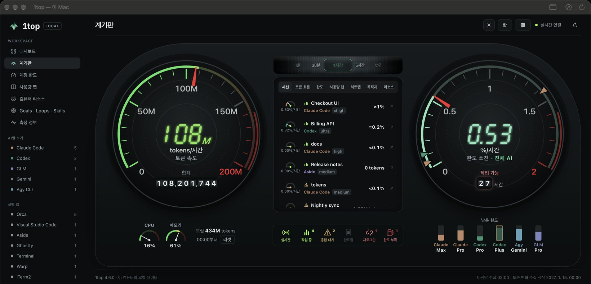

## Download

| | Platform | Get it |
| :---: | --- | --- |
|  | **macOS** · Apple Silicon, macOS 13+ | [**1top-4.8.0-macos-arm64.dmg**](https://github.com/awesomezun/1top/releases/download/v4.8.0/1top-4.8.0-macos-arm64.dmg) |
|  | **Windows** · x64 | [**1top-4.8.0-windows-x64-setup.exe**](https://github.com/awesomezun/1top/releases/download/v4.8.0/1top-4.8.0-windows-x64-setup.exe) |
|  | **Android** 7+ | [**1top-4.8.0-android.apk**](https://github.com/awesomezun/1top/releases/download/v4.8.0/1top-4.8.0-android.apk) · Google Play coming soon |
|  | **iPhone** | App Store coming soon |
| 🌐 | **Browser** | [1top.si/app](https://1top.si/app?demo=1) — the demo needs no install |

4.8.0 is a preview. The files, `SHA256SUMS` and `build-info.json` are in the [release](https://github.com/awesomezun/1top/releases/tag/v4.8.0). The Mac app is not notarized yet and the Windows installer is not code-signed yet, so macOS and Windows may ask you to confirm the first launch.

**New in 4.8.0:** compare measured usage with your subscription cost, review weekly working and waiting time, and receive local quota and weekly-summary notifications. Unknown model prices and plan costs stay separate from confirmed savings.

## What you can see

| Part | What it shows |
| --- | --- |
| **Cluster** | Token speed and limit-burn dials, hours of work left at the current pace, warning lights for what needs you, a fuel gauge per account and a trip counter. |
| **Sessions** | Computer, app, terminal, AI tool, model, reasoning effort, state, account, CPU and memory. Subagents fold under the session that started them. |
| **Conversations** | Send a question or an instruction with up to three photos and read the answer, with Markdown, in 1top. Works with Claude Code, Codex and GLM in a verified Orca terminal, and with Aside. |
| **Account limits** | 5-hour and weekly windows for Claude Code, Codex, Agy CLI and GLM accounts, with reset times and how fast each one is going. |
| **Usage** | Input, cached input, cache writes and output; token flow and usage maps by session, app, tool or model, from 10 minutes to all history. |
| **Goals, Loops, Skills** | Codex Goals, Claude Code Goals, `/loop` and scheduled tasks, and the skills installed for each tool. |
| **Controls** | Bring a session's app forward, interrupt and resume a turn where supported, or end a CLI. |
| **Customizing** | Move, hide, resize and restyle the cluster's and the dashboard's parts on each device. |

Usage counts reported tokens, not a provider invoice or subscription balance. Unknown values stay unknown, and partial history is marked.

## Screenshots

Every screenshot uses invented example data, the same as the [browser demo](https://1top.si/app?demo=1). The apps run in Korean, English and Chinese.

### Dashboard

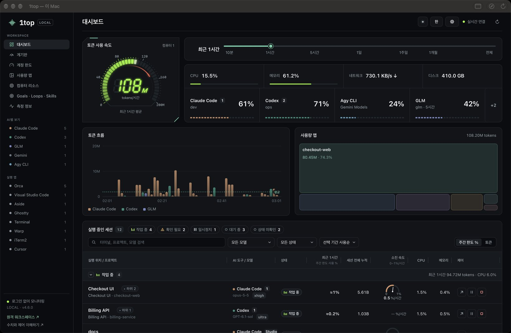

| Sessions | Usage maps |
| --- | --- |
| 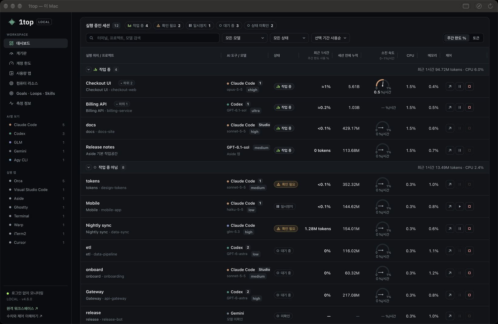 | 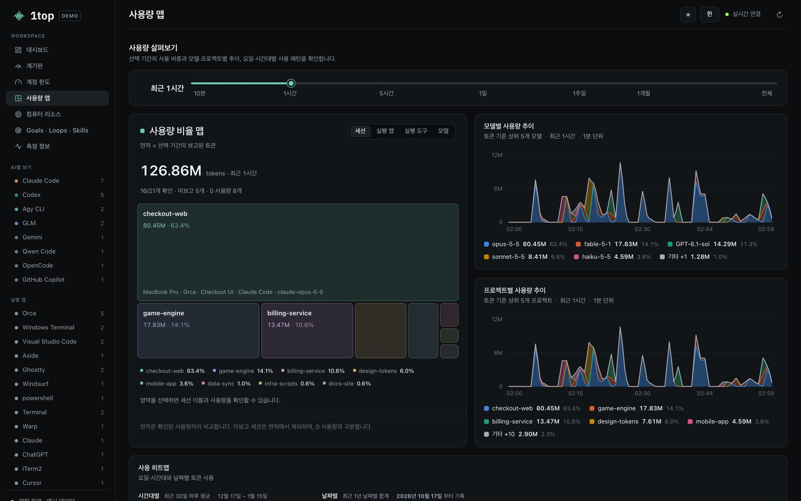 |
| **Talk to a session** | **Account limits** |
| 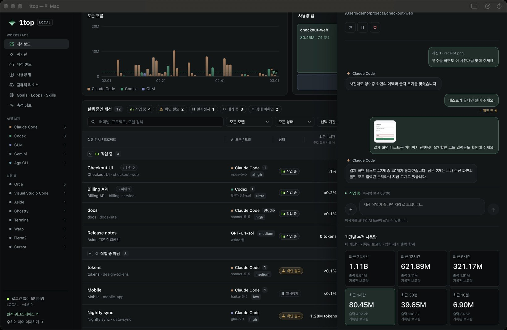 | 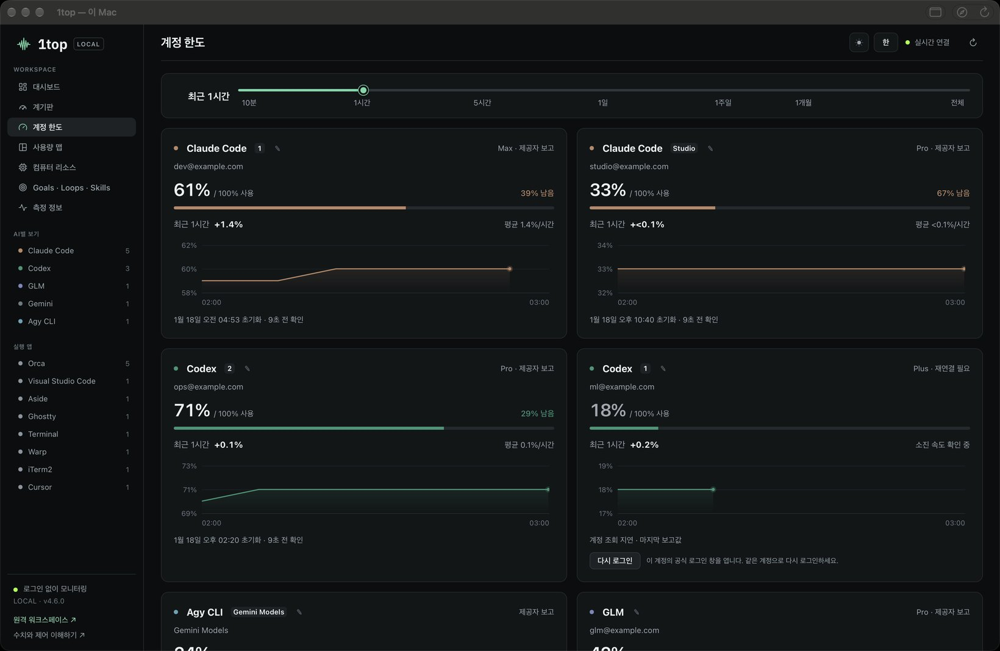 |
| **Token flow on the cluster** | **Limits on the cluster** |
| 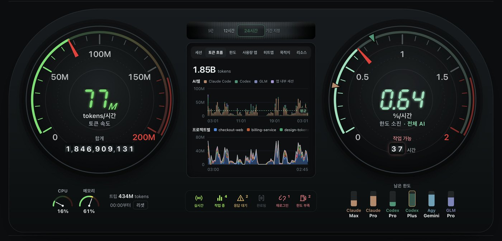 | 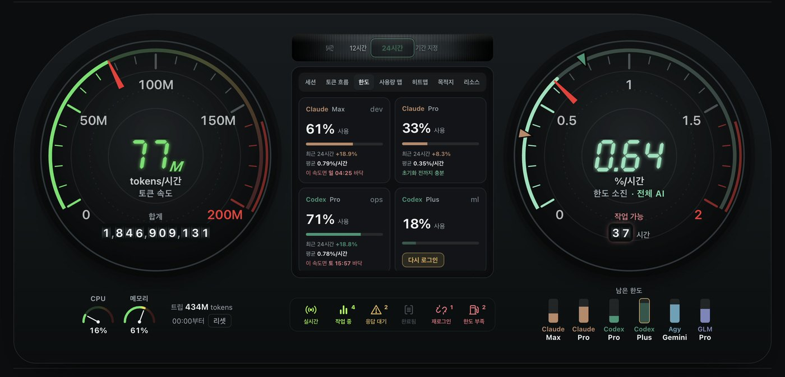 |

### Menu bar and tray

| macOS menu bar | As a cluster | Windows tray |
| :---: | :---: | :---: |
| 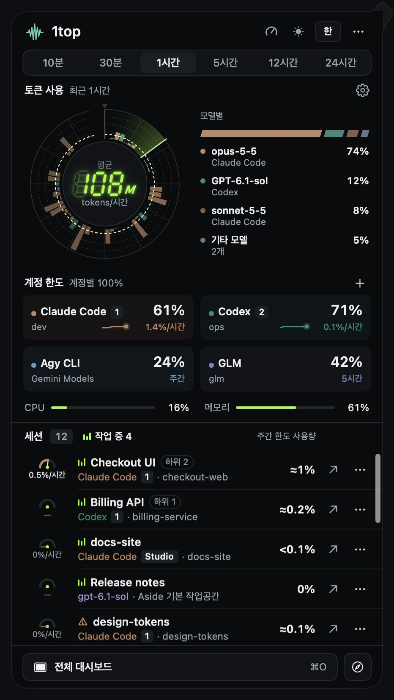 | 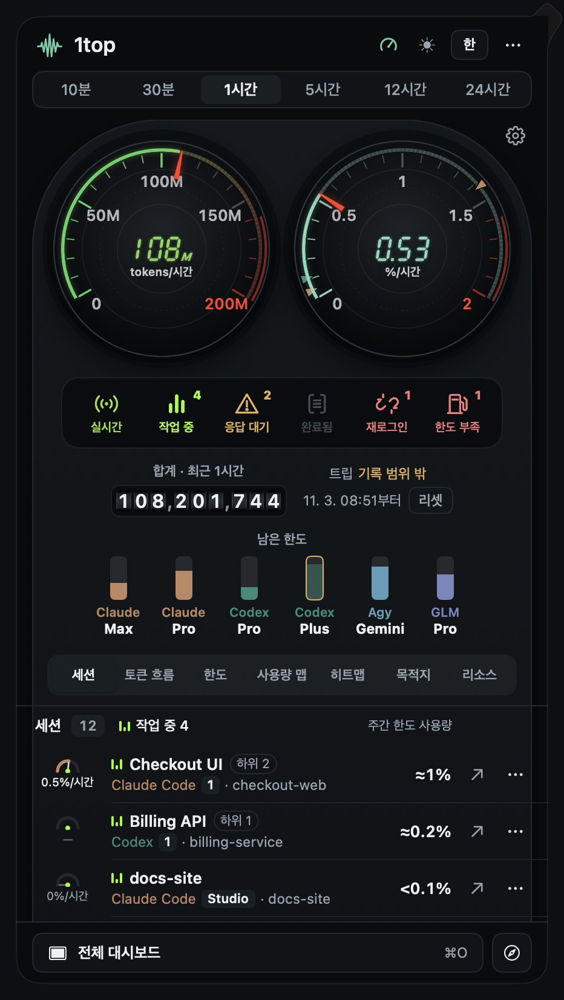 | 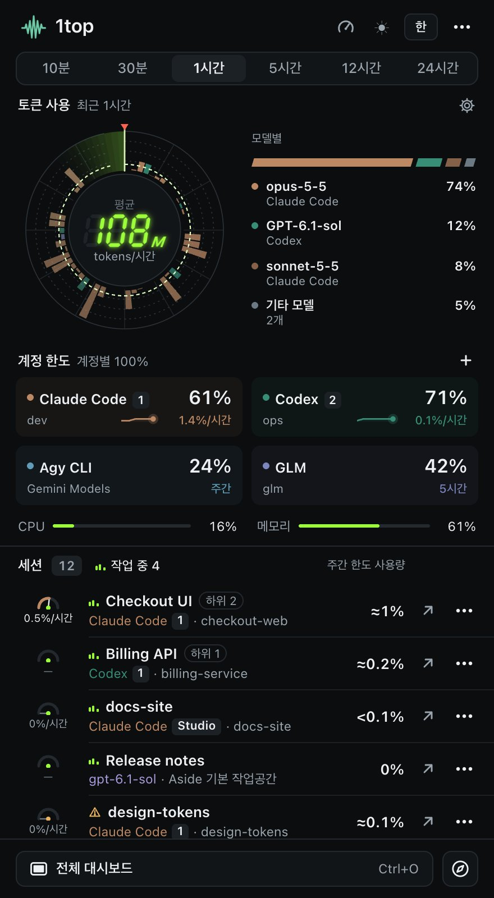 |

### iPhone and Android

| | Dashboard | Cluster | Sessions | Limits |
| :---: | :---: | :---: | :---: | :---: |
| **iPhone** | 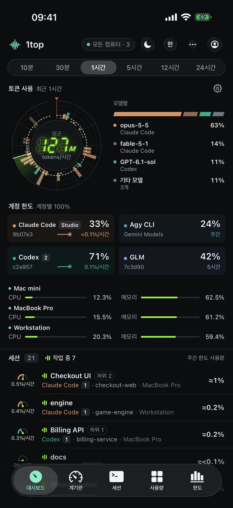 | 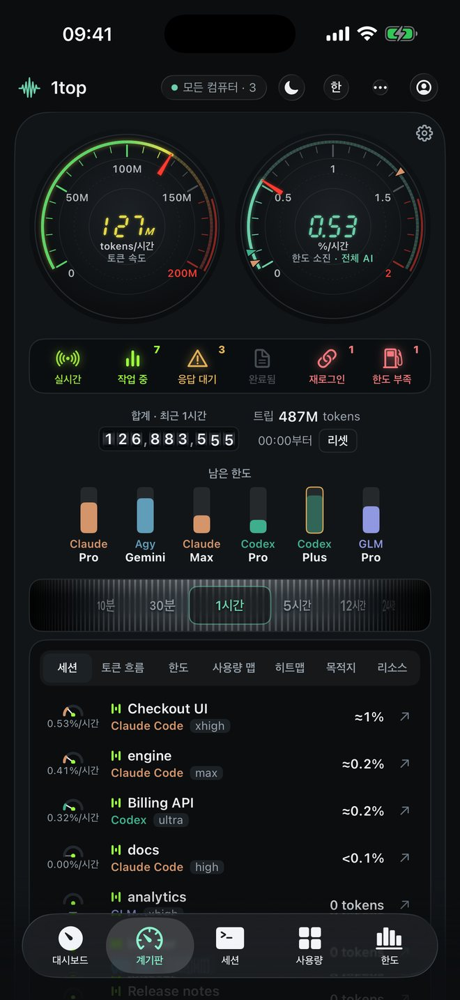 | 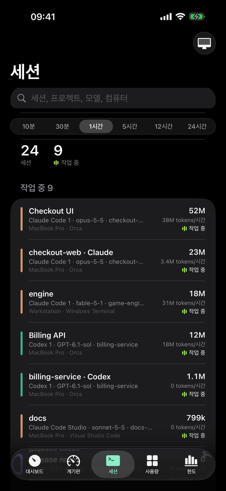 | 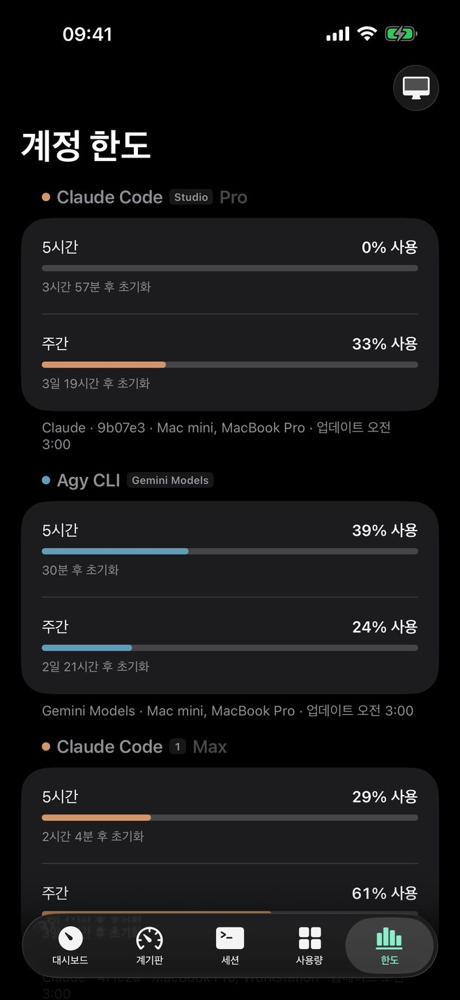 |
| **Android** | 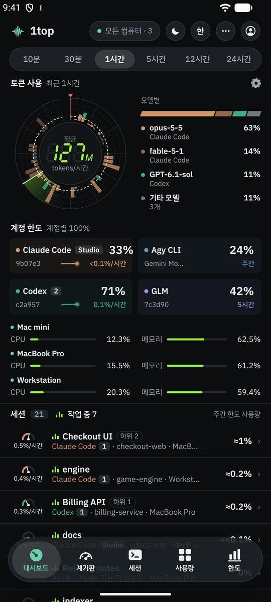 | 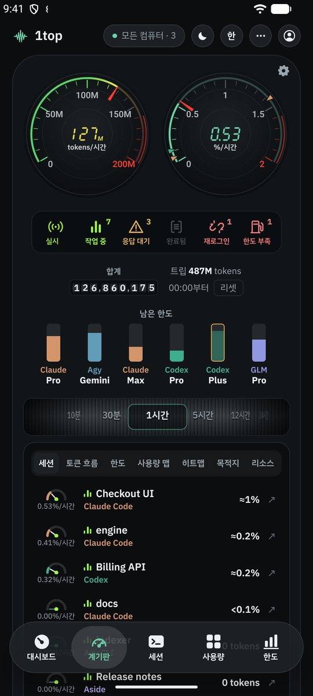 | 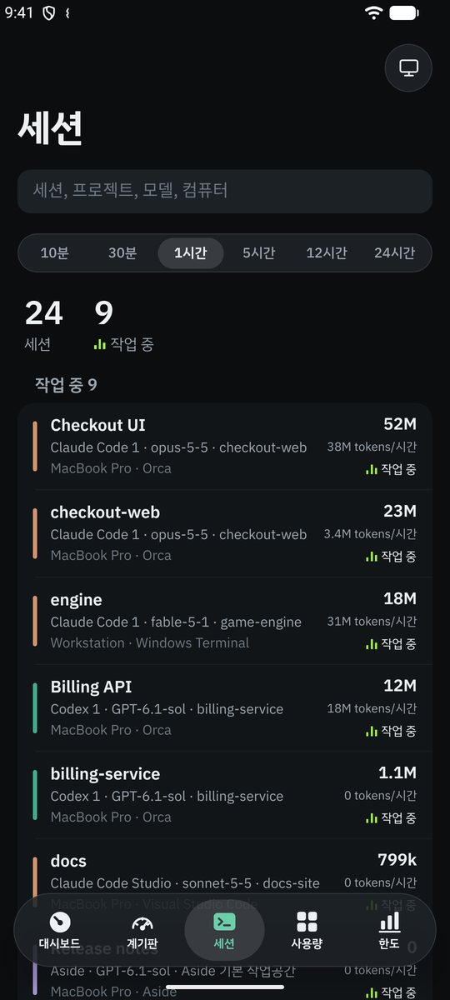 | 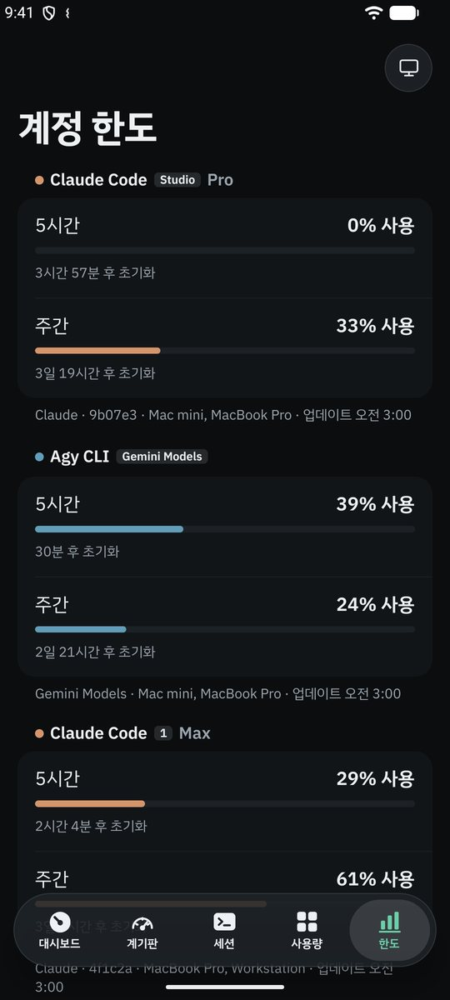 |

## How it works

```text
 macOS menu bar · Windows tray · dashboard window · this computer's browser
                              │
                 1top collector on 127.0.0.1 (loopback only)
                              │
        local usage records · processes · Goal and skill files
                              │  (optional, outbound only)
                    1top relay ──── iPhone · Android · 1top.si/app
```

The desktop app reads what each AI tool records on your computer and serves it on the loopback address. Local monitoring needs no account. When you connect a phone or the web, the computer sends a summary out through the relay; it never opens a port.

Controls need a fresh report, an allowed capability and the exact session key. Commands expire, are never queued for an offline computer, and run at most once. PID and start-time checks guard against PID reuse, and ending a CLI sends SIGTERM to that process only.

## Privacy

Your sessions, usage and history stay on your computer. Summaries sent through the relay carry device, app and session labels, model names, token totals, resources and control results; they leave out conversations, full file paths, API keys, environment variables, command-line arguments, Goal text and skill paths. An instruction you send goes to the session you chose; the relay keeps a fingerprint for duplicate checks, not the text. See the [privacy policy](https://1top.si/privacy).

## Build from source

Requires Python 3.11+ and Node.js; macOS also needs the Xcode Command Line Tools.

```bash
python3 -m venv .venv
.venv/bin/pip install -e . pyinstaller
.venv/bin/python -m unittest discover -s tests -q
.venv/bin/1top local
```

Build the Apple Silicon app with `scripts/build-macos.sh` (it lands in `build/1top_v<version>/1top.app` with a local ad-hoc signature), or Windows with `scripts/build-windows.ps1`. [`.github/workflows/checks.yml`](.github/workflows/checks.yml) lists every check.

## Contributing

See [CONTRIBUTING.md](CONTRIBUTING.md) for adding a tool adapter, and report vulnerabilities privately as described in [SECURITY.md](SECURITY.md). Please never attach credentials, real conversation logs or private screenshots to a public issue.

[MIT license](LICENSE)
